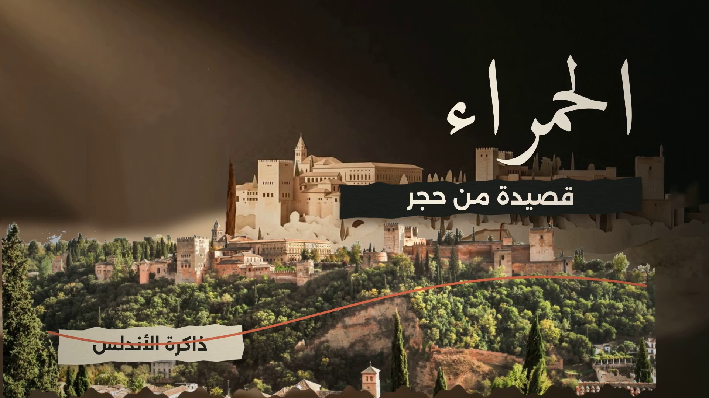

# الحمراء — قصيدة من حجر
## نسخة الموشح الغنائي

**الفيلم مكتمل: 05:10.469 · 1920×1080 · 32fps · 9,935 إطارًا**

**المونتاج والتصميم بواسطة شذى ياسر**



### المشاهدة والتنزيل

- **[النسخة الرئيسية المحدثة — 67.2 MB](renders/final/alhambra-muwashah-1080p32-master.mp4)**
- **[نسخة العرض الخفيفة — 35.0 MB، بنفس 1080p و32fps](renders/final/alhambra-muwashah-viewing-1080p32.mp4)**
- [النسخة السابقة قبل إضافة الموشح](renders/versions/pre-muwashah/alhambra-cinematic-viewing-1080p32.mp4)
- [الماستر السابق](renders/final/alhambra-cinematic-1080p32.mp4)
- [المصادر والتراخيص](CREDITS.md)

## التعديل الجديد

عند **02:48.406** يتوقف اقتباس المعلّق المنطوق ويبدأ الموشح الحقيقي من الملف المقدّم. تستمر الفقرة **45.625 ثانية**، دون تراكب الراوي أو موسيقى الخلفية السابقة. تعود جملة **«كتبها لسان الدين بن الخطيب»** عند **03:34.031**.

الكلمات تظهر على توقيت الغناء، مع نبض وحركة محدودة تتبع الموسيقى. الخيط الأحمر يصبح خطًا موسيقيًا، والماء يتفاعل مع الضربات، والمطر البصري مرتبط بكلمة «الغيث». الكاميرا مستمرة عند 32fps، والحروف داخل كل كلمة عربية تبقى متصلة.

التسجيل المقدّم، وفق وسومه: **Sami Yusuf — En al-Ándalus، ألبوم Alma**. المقتطف: **09:24.125–10:09.750**. لم يُغيّر الإيقاع أو المغنّي. وفي النهاية يظهر تتر شذى ياسر لمدة سبع ثوانٍ.

## الملفات الرئيسية

- `src/muwashah-v4/` — امتداد المحرك للموسيقى والكلمات والتتر وعودة المعلّق.
- `src/muwashah-v4/edit-map.json` — خريطة الاستبدال والأزمنة والإطارات.
- `src/muwashah-v4/music-data.json` — النص العربي الصحيح، توقيت الكلمات وطاقة الصوت والضربات.
- `docs/muwashah-v4-edit-notes.md` — تفاصيل التعديل وحدود المراجعة.
- `docs/muwashah-v4-production-sheet.csv` — 33 وحدة تجميع مع أزمنتها وبصماتها ونسخ Git التي تحفظها.
- `research/muwashah-v4-render.json` — manifest النسخة الجديدة.
- `research/muwashah-v4-finalization.json` — نتائج التحقق من الملف النهائي.
- `research/muwashah-v4-audio-report.json` — تحرير الصوت وقياساته.
- `renders/muwashah-v4/segments/` — الأجزاء الجديدة المرفوعة فور اكتمالها.
- `renders/muwashah-v4/audio/` — مزيج الصوت المستمر للنسخة الجديدة.
- `src/cinematic/` و`research/render-checkpoints.json` — المحرك والأجزاء الأصلية، محفوظة دون تغيير.
- `assets/generated/` — اللوحتان السينمائيتان والأصل الحجري التصوري.
- `assets/audio/` — جميع ملفات المستخدم الأصلية.
- `references/style-reference-videos-originals.zip` — المقاطع المرجعية الاثنا عشر، مع بصماتها.
- `vendor/` — نسختا AI Film Studio وmotion-reel في المستودع.

## التحقق

- 1920×1080، ومعدل ثابت **32fps** يبدأ من الزمن صفر.
- **9,935 إطارًا**، وفحص فك الترميز الكامل ناجح.
- استُخدم **24 جزءًا من الفيديو السابق بلا إعادة ترميز فيديو في تجميع الماستر**؛ نُفذت الأجزاء المعدّلة فقط. نسخة العرض الأخف معادة الضغط بنفس الدقة.
- الصوت داخل فقرة الموشح يطابق المقتطف المقدّم؛ معامل الارتباط الموجي المقاس **0.998** بعد المعالجة والترميز.
- حزم الصوت المحتفظ بها في الفيلم مطابقة لمزيج النسخة الجديدة؛ حُذف فقط حشو AAC الزائد عند النهاية.
- مستوى الصوت المقاس نحو **−14.47 LUFS** و**−1.97 dBTP**.
- روجعت صور فعلية من الملف المرمّز، بما فيها الكلمات العربية وتتر شذى ياسر. هذه فحوص محددة وليست ادعاءً باستماع بشري لكل ثانية أو باعتماد المستخدم النهائي.

## الاستعادة

لا تحتاج الملفات العامة المنشورة إلى توكن للتنزيل. لاستعادة الأجزاء الدقيقة إلى تخزين التشغيل دون ملء مساحة اللقطة:

```bash
python3 tools/restore_muwashah_v4.py --destination /home/user/.cache/alhambra-restore-v4
```

الأداة تتحقق من SHA-256 ومعرّف commit لكل قطعة. تجميع النسخة يتم بإزالة صوت القطع المؤقت من مسار الفيديو، ثم إرفاق مزيج الصوت المستمر؛ الوصفة موجودة في `tools/render_muwashah_v4.py`.

للأصول والتبعيات، راجع `tools/restore_environment.sh`. إذا فُقد ملف premix المؤقت، يمكن إعادة بنائه من الملفات الأصلية عبر `tools/prepare_film_audio.py` قبل تشغيل إعداد الموشح. أداة التصيير المنشورة تنتظر تأكيد النسخ إلى المستودع بعد كل جزء؛ لا تدّعي أنها نشرت شيئًا دون تأكيد الرفع.

## الحفاظ على النسخ والمساحة

النسخة السابقة موجودة في المستودع بمساراتها الأصلية ونسخة أرشيفية مسماة. نُقلت نسخة المشاهدة المحلية السابقة إلى تخزين التشغيل **بعد تأكيد رفعها** لإتاحة مكان للنسخة الجديدة ضمن سقف مساحة العمل. لم تُحذف بياناتها أو ملفات الصوت الأصلية.

لا يستخدم المشروع `out/` ولا يخزن آلاف الصور الوسيطة؛ الإطارات تُرسل إلى FFmpeg مباشرة. النسخة الرئيسية الأعلى جودة محفوظة في GitHub، ونسخة العرض المحلية أخف بنفس الأبعاد والإطارات. هذا ليس ادعاءً بضغط فيديو بلا فقد بصري.

**لا توكنات أو بيانات اعتماد في ملفات المشروع.** رخصة الشيفرة أو المهارات لا تمتد تلقائيًا إلى التسجيلات والصور؛ راجع `CREDITS.md` قبل إعادة الاستخدام.
