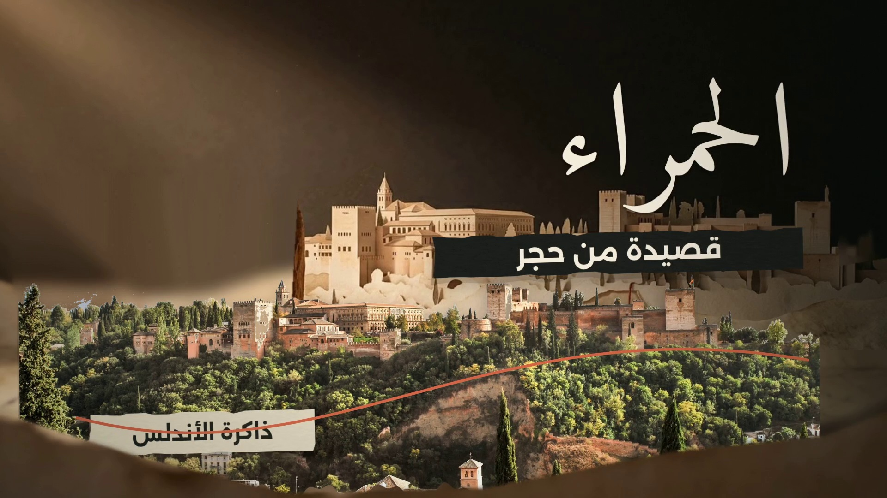

# الحمراء — قصيدة من حجر
## الإصدار الخامس: بناء حركي مستقل الطبقات

**الفيلم مكتمل · 05:36.188 · 1920×1080 · 32fps · 10,758 إطارًا**

**المونتاج والتصميم بواسطة شذى ياسر**



### المشاهدة والتنزيل

- **[النسخة الرئيسية عالية الجودة — 135.2 MB](https://github.com/zoih6/alhambra-vox-cinematic-2026-10-19/releases/download/v5-layered-motion/alhambra-layered-v5-1080p32-master.mp4)**
- **[نسخة العرض — 44.6 MB، بنفس 1080p و32fps](renders/final/alhambra-layered-v5-viewing-1080p32.mp4)**
- [صفحة الإصدار والماستر](https://github.com/zoih6/alhambra-vox-cinematic-2026-10-19/releases/tag/v5-layered-motion)
- [المصادر والتراخيص](CREDITS.md)
- [النسخة السابقة — موشح v4](renders/final/alhambra-muwashah-viewing-1080p32.mp4)

الماستر محفوظ كأصل إصدار في GitHub لأنه يتجاوز حد الملف المعتاد في Git. نسخة العرض مضغوطة أكثر مع إبقاء الأبعاد والإطارات؛ ليست هذه دعوى ضغط فيديو بلا فقد بصري.

## ما تغير فعليًا

- أزيل دخول المجموعة المشترك بـPosition/Scale/Opacity، وأزيل المسح الورقي العام بين جميع المشاهد.
- بُني النص العربي بأقنعة مستقلة لجسمه وصواعده ونوازله ونقاطه، مع تشكيل الكلمة كاملة أولًا كي لا تنفصل الحروف المتصلة.
- الصورة، ورقتها، ظلها، مساراتها، أرقامها وتسمياتها لها ساعات وخصائص مستقلة. تظهر الواجهة والانعكاس في بهو الريحان على مرحلتين منفصلتين.
- الخطوط والدوائر والتسطيرات تُرسم تدريجيًا حسب طول المسار، ونهاياتها تتبع الرسم.
- استُبدلت ورقة «نصر» بصورة تخيلية لابن الأحمر. أضيفت صورة تخيلية للشاعر، ويدان وحجر للبناء، ومفتاح توضيحي، مع قصّ خلفياتها وتنظيف حوافها. الصور التخيلية ليست أدلة تاريخية وتُوسم بذلك.
- مسار الكاميرا مؤلّف بمفاتيح مقصودة، لا تكبير عشوائي لكل لقطة، ولا بديل عن حركة العناصر.
- التتر يُبنى كلمة وعلامة وتسطيرًا، لا كتلة واحدة.

**الخطوط والنصوص الأساسية والهوية اللونية محفوظة.** التنفيذ الفعلي بمحرك Canvas/Playwright/FFmpeg؛ لا يُقدَّم ملف After Effects أصلي أو ادعاء تشغيل Adobe هنا.

## الغناء الذي حدده المستخدم

المقتطف من الملف الأصلي هو **10:18.670–11:30.000** بالضبط، أي **71.330 ثانية**. لا يُستخدم جزء الموال السابق، ولا يُراكب صوت الراوي فوق الغناء، ولا تتغير سرعة التسجيل.

في الفيلم: تبدأ الفقرة عند **02:48.406** ويعود الراوي عند **03:59.750**. يوجد صمت تقني مقداره **13.75 ملي ثانية** فقط بعد نهاية المصدر لمطابقة شبكة 32fps، دون أخذ صوت من خارج المدى المحدد.

التسجيل، وفق وسوم الملف المقدّم: **Sami Yusuf — En al-Ándalus، ألبوم Alma**. الكلمات المصححة وتوقيتها وتفاعل الخط والماء تأتي من النص الزمني المضمّن والتحليل المحلي للصوت.

## ملفات التنفيذ والمراجعة

- `src/layered-v5/layer-core.js` — الأقنعة، تشكيل النص، الصور والورق والظلال، وترتيب الطبقات.
- `src/layered-v5/layer-scenes.js` — البناء الخاص بالمشاهد، الرسوم والشخصيات، عوالم الغناء والتتر.
- `src/layered-v5/layer-plan.json` — الحالات والتوقيت والعمق والعلاقات قبل التنفيذ.
- `src/layered-v5/chorus-data.json` — الكلمات الصحيحة ومواعيدها والطاقة والضربات المستخرجة.
- `docs/v5-independent-layer-sheet.csv` و`docs/v5-chorus-and-credit-layer-sheet.csv` — خطط الحركة القابلة للفحص.
- `docs/v5-motion-implementation.md` — شرح التنفيذ الفعلي وحدوده.
- `research/v5-finalization.json` — تحقق الملف النهائي.
- `research/v5-render-manifest.json` — الأجزاء الحالية، بصماتها وcommits التي تحفظها.
- `research/v5-release-published.json` — رابط الماستر وبصمته وبيانات أصل الإصدار.
- `assets/layered-v5/` — القصاصات الشفافة والأجزاء المسجلة بدقة.
- `renders/layered-v5/` — أجزاء التصيير والصوت المنشورة.

## نتائج التحقق

- **34 جزءًا حاليًا** محفوظًا قبل الدمج؛ أعيد بناء حركة الفيلم كاملًا.
- فحص فك الترميز الكامل، وتتابع الإطارات الثابت عند 32fps، وبداية الزمن من الصفر: ناجحة.
- مراجعة 50 عينة مشهد من النسخة المرمزة، مع شريط فعلي لتقدم الأقنعة والتتر.
- تطابق حزم صوت الفيلم مع المزيج المستمر، ومقارنة المقطع الغنائي بالمصدر بمعامل ارتباط موجي **0.999**.
- مستوى المزيج نحو **−14.42 LUFS**، والذروة الحقيقية **−1.93 dBTP**.
- بصمة أصل الإصدار المنشور مطابقة للماستر المحلي.

هذه فحوص محددة ومراجعة صور فعلية من الفيديو؛ ليست دعوى استماع بشري لكل ثانية أو اعتماد المستخدم النهائي.

## الاستعادة دون بيانات اعتماد

```bash
python3 tools/restore_layered_v5.py --master --destination /home/user/.cache/v5-restored
python3 tools/restore_layered_v5.py --segments --destination /home/user/.cache/v5-restored
```

الأداة تتحقق من SHA-256. لا تفترض أن جميع الأجزاء في مجلد build واحد؛ بعضها احتُفظ به بعد التصحيح المحدود لتسمية «حجر»، وكل جزء يحمل مساره وcommit الصحيحين في manifest.

لاستعادة أدوات التنفيذ المؤقتة: `bash tools/restore_environment.sh`. تبقى ملفات الخطوط والصور والأصوات الأصلية داخل المشروع؛ راجع أدوات الإعداد إن لزم إعادة بناء PCM المؤقت. تعديل المحرك يتم في ملفات المصدر ثم `python3 tools/build_layered_v5.py`، وليس في ملف `engine.js` المجمّع وحده.

## الحفاظ على النسخ والمساحة

لم تُحذف بيانات النسخ السابقة. الماسترات ونسخ المشاهدة والأجزاء والمراجع موجودة في المستودع وإصداراته. أُرشفت مخرجات مشتقة قديمة بعد التحقق من رفعها:

- `archives/static-v1-full-resolution.zip`: الفريمات الثمانية الأصلية، كاملة الدقة وببصماتها.
- `archives/prior-renders/film-mix-v2.m4a`: المزيج السابق المشتق، وليس أحد الأصوات الأصلية.
- `renders/versions/pre-muwashah/`: نسخة مشاهدة سابقة مسماة.

لوحة المعاينة الأولى المستقلة وشيت الفريمات ما زالا محليين. لا يستخدم المشروع `out/` ولا يحتفظ بآلاف الصور الوسيطة. توجد نسخة العرض الحالية محليًا ضمن سقف اللقطة، والماستر الأعلى جودة في GitHub Releases.

**لا توكنات في ملفات المشروع.** التسجيلات والصور لها حقوقها الخاصة؛ نشر الشيفرة لا يمنح تلقائيًا ترخيص إعادة استخدامها. راجع `CREDITS.md`.
